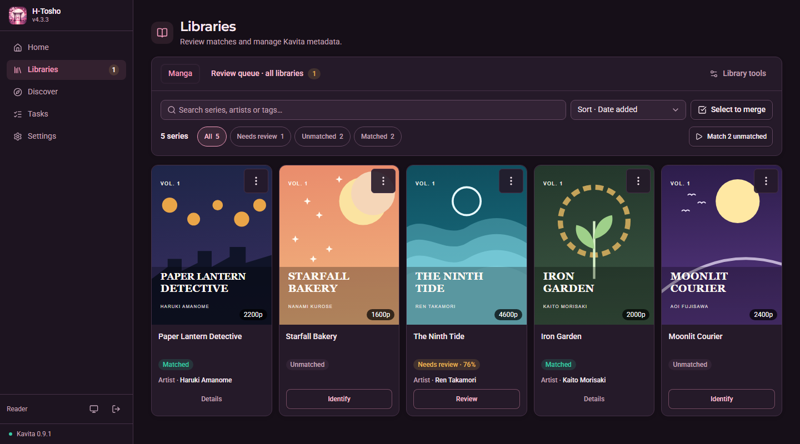
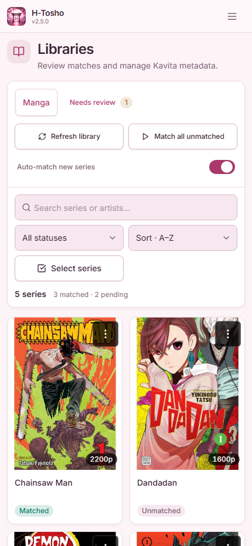

# H-Tosho

**Give your Kavita library better titles, descriptions, tags, and covers.**

H-Tosho helps you identify manga and light novels, review metadata before applying
it, and keep new additions organized. It also includes a doujinshi downloader,
recommendations, and watched searches for new releases.

Works with **Kavita v0.9.x or newer**. Current version: **v2.6.0** ·
[Release notes](CHANGELOG.md)



*The actual interface with a sample library. Covers are from the official VIZ
shop; counts, match results, and metadata are example data.
[Screenshot details and cover credits](docs/screenshots/README.md).*

[Install](#install) · [First setup](#first-setup) ·
[Use your library](#use-your-library) · [Discover and download](#discover-and-download) ·
[Help](#help)

## What you can do

- **Clean up your library.** Find a series through AniList, MangaDex, or
  MyAnimeList, compare it with your current Kavita metadata, and choose what to
  update.
- **Keep new series organized.** Enable automatic matching and review uncertain
  results in **Needs review**.
- **Discover and download doujinshi.** Search Hitomi.la or nHentai, preview
  galleries, and save them as CBZ files or image folders.
- **Follow artists and searches.** Save a query and see new finds in
  **Recently added**, with optional Discord notifications.
- **Get recommendations you can tune.** Ask for more like a gallery, mute an
  artist, or dismiss a pick you do not want.
- **Fix files and organize series.** Edit ComicInfo.xml inside CBZ files and
  merge related series.

## Install

### Docker

Install Docker with Docker Compose, then download or clone this repository:

```bash
git clone https://github.com/hiranaka99/H-Tosho.git
cd H-Tosho
docker compose up -d --build
```

Open **http://localhost:8787**. If Docker runs on another machine, use that
machine's address with port `8787`.

Your account, settings, and history are saved in the `h-tosho-data` volume.
Keep this volume when updating or recreating the container.

If you want to download galleries or edit existing CBZ files, also set up the
[library folders](#make-your-library-folders-accessible) below.

### Without Docker

Install **Node.js 22 or newer**, download or clone the repository, and run these
commands from its folder:

```bash
npm install
npm start
```

Open **http://localhost:8787**. App data is saved in `server/data` by default;
`HTOSHO_DATA_DIR` lets you choose another location.

## First setup

1. **Create your H-Tosho account.** Choose a username and a password of at least
   eight characters. You will use this account to sign in to this installation.
2. **Connect Kavita.** Create an Auth Key for a Kavita admin account under
   **User Settings → Manage Auth Keys**. In H-Tosho, open
   **Settings → General → Kavita connection**, enter your Kavita address
   without `/api` and the Auth Key, then choose **Save & test connection**.
   The sidebar shows the connection status.
3. **Choose your metadata sources.** Open **Settings → Providers**. AniList and
   MangaDex work without credentials. MyAnimeList needs a Client ID. Enable the
   sources you want and arrange their search order.
4. **Open Libraries.** Select a library and click a series to identify it.

For Docker, the Kavita address must be reachable **from the H-Tosho container**.
Use a hostname such as `http://kavita:5000` when both containers share a Docker
network, or your Kavita server's network address. `localhost` inside the
H-Tosho container refers to H-Tosho itself.

### Make your library folders accessible

Metadata matching uses your Kavita connection. Renaming series through their
CBZ metadata, editing ComicInfo.xml, and moving or merging files also need
access to the library folders with write permission.

For Docker, add your folders to the `volumes` list in `docker-compose.yml`:

```yaml
volumes:
  - h-tosho-data:/data
  - /srv/books/manga:/mnt/manga
  - /srv/books/doujinshi:/mnt/downloads
```

Replace the paths on the left with folders on your Docker host. Restart with
`docker compose up -d`, then open
**Settings → General → Kavita library folders**. Map each Kavita folder to the
same folder as H-Tosho sees it:

| Folder shown by Kavita | Folder available to H-Tosho |
| --- | --- |
| `/media/Manga` | `/mnt/manga` |
| `/media/Doujinshi` | `/mnt/downloads` |

Choose **Save folders**. Leave a mapping empty if Kavita's path is already
accessible from H-Tosho. Map every root you need when a library has several
folders.

For new downloads, set **Settings → Downloader → Output folder** to
`/mnt/downloads` and make sure Kavita also has a library pointed at that shared
folder. Enable **Auto-sync Kavita** to request a scan after downloads finish.

Prefer app data and downloads in local folders? The included
[bind-mount example](docker-compose.example.yml) uses `./data` and `./downloads`:

```bash
docker compose -f docker-compose.example.yml up -d --build
```

With this example, use `/mnt/downloads` as H-Tosho's output folder.

## Use your library

### Identify a series and review the changes

1. Open **Libraries**, choose a library, and click a series cover.
2. Choose **Review changes** for the current match, or select another candidate,
   to compare its metadata with the current Kavita values.
3. Uncheck any fields you want to keep, and choose a title if alternatives are
   offered.
4. Choose **Apply & Sync**. H-Tosho applies your selection in the background;
   **Jobs** shows its progress and any warnings.


*Review the title, description, creators, tags, and cover before applying them.
This preview uses sample metadata and real cover art.*

If the suggested match is wrong, paste the series' AniList, MangaDex, or
MyAnimeList URL under **Use a provider URL** and choose **Load**.
Provider search diagnostics are expandable below the matches. Sync progress
and warnings are available in **Jobs**.
Use **Back to matches** to compare another candidate; your provider filter and
list position are preserved. Applying stays disabled until both current and
proposed metadata are available. Failed requests offer a retry.

Applied series and volume covers are locked in Kavita so later scans keep them.
Changing a title also updates the Series field in the series' CBZ files, so
configure your library folders before renaming.

### Match new additions automatically

Turn on **Auto-match new series** for the libraries you want to monitor. Set
the check frequency under **Settings → General → Auto-scan interval**.
Use **Match all unmatched** to work through an existing library.
Refresh and matching actions show when they are queuing, then display library
job progress on the page, including on mobile. Choose **View job** for details.

Unconfirmed matches below 80% confidence appear in **Needs review**. Open a
result, review the candidate, and apply it to confirm the match.

Libraries defaults to **Sort · Date added**, showing the newest series first.
Your selected sort order is remembered for the current browser session.

### Edit metadata or merge series

Open a series card's **⋮** menu and choose **Edit ComicInfo.xml** to edit its
CBZ metadata. Use raw XML mode when you need a field beyond the form.

To combine related series, choose **Select series**, select the ones to combine,
and use the merge action. H-Tosho needs writable access to their files.

<details>
<summary>See the mobile interface</summary>

<p>The same library tools are available on a phone, with navigation in the menu.</p>


</details>

## Discover and download

Open **Downloader** to access four tabs:

| Tab | What to do here |
| --- | --- |
| **Search** | Search Hitomi.la or nHentai by keyword, tag, artist, or gallery ID. Preview a result, then download it or select several. |
| **Recommended** | Browse up to twelve picks, select the Kavita libraries that inform your preferences, and use **Refresh picks** for another set. |
| **Watched** | Manage saved searches and browse new finds in **Recently added**. |
| **Downloads** | Track progress, pause or resume downloads, retry failures, and view completed downloads. |

Before downloading, open **Settings → Downloader** and choose your output
folder and format. **CBZ** puts each gallery in an archive; **Folder** saves its
images in a directory. You can also set download concurrency, excluded tags,
and an optional nHentai API key. The Downloader shows the current folder and
format, and offers **Set output folder** before you can queue your first download.

Each source remembers its own search, unfinished input, and sort order. Switching
sources restores that source's search without translating or dropping filters.

H-Tosho prevents duplicate queued downloads and remembers galleries downloaded
through the app. To remove unwanted recommendations, open a card's **Tune
recommendations** menu and choose **Don’t recommend this gallery**. Use **Undo**
to restore a dismissed gallery.

### Tune your recommendations

Use a card's **Tune recommendations** menu to choose **More like this**, dismiss
the gallery, or mute an artist. More like this influences the next refresh; a mute immediately hides
recommendations featuring that artist, including collaborations.

The **Feedback** button beside **Refresh picks** lets you undo saved preferences
or unmute artists. Use thumbs down to dismiss a single gallery, and
**Dismissed galleries** to undo dismissals. These choices survive restarts.

### Watch for new releases

Run a search, then choose **Watch** to save that query. Under **Watched**, choose
how often to check it or use **Check now** to check manually.

The first check records the existing results quietly. Later checks add new
finds to **Recently added** and send Discord messages if notifications are
enabled. Results with a known upload date older than fourteen days are skipped
to keep old galleries from being announced as new. Results without a usable
upload date are still eligible.

Watches find galleries for you; choose the ones you want to download from the
feed.

### Enable Discord notifications

Open **Settings → Notifications**, enable Discord, paste your channel's webhook
URL, save, and send a test message. Notifications include metadata updates and
new watched-search results.

## Help

| Problem | What to check |
| --- | --- |
| **Kavita will not connect** | Test the connection in Settings. Check the server address and admin Auth Key. In Docker, use an address reachable from the container. |
| **A title will not change, or a CBZ cannot be edited** | Check write permissions and **Kavita library folders**. The mapped path must point to the same files Kavita uses. Open the job for the specific warning. |
| **The cover has not updated** | Wait for **Apply & Sync** to finish. Check **Jobs** for cover-upload errors, then refresh the library. |
| **A download failed** | Open **Downloads → Needs attention** for the error. Check the output folder and source settings, then retry. An nHentai API key can help with rate limits. |
| **A watch has no new results** | Its first check is silent. Check the saved query and interval, or use **Check now**. Old uploads are suppressed when their date is known. |

**Jobs** contains the results and logs for scans, matches, merges, edits, and
watched-search checks. Failed jobs offer retry and, where available, a link to
the relevant setting. Clearing failed-job history removes its logs, not library
files.

### Update and back up

For a Git checkout running in Docker:

```bash
git pull
docker compose up -d --build
```

If you use the bind-mount example, include `-f docker-compose.example.yml` in
the Compose command. For a source installation, stop the app, update the
checkout, run `npm install`, and restart with `npm start`.

Back up your app data and library folders. Stop H-Tosho before copying its data
folder or Docker volume for a consistent backup. Keep the existing data volume
when upgrading; do not use `docker compose down -v` unless you intend to erase
the saved app data.

### Access from another device

The included Docker configuration exposes port `8787` on the host. A source
installation listens on `127.0.0.1` by default; set `HOST=0.0.0.0` when you want
to reach it over your network. Sign in with your H-Tosho account on each device.

Found a problem? [Open an issue](https://github.com/hiranaka99/H-Tosho/issues)
with your H-Tosho version, what you expected, and the relevant job error. Remove
passwords, Auth Keys, and webhook URLs from anything you share.
