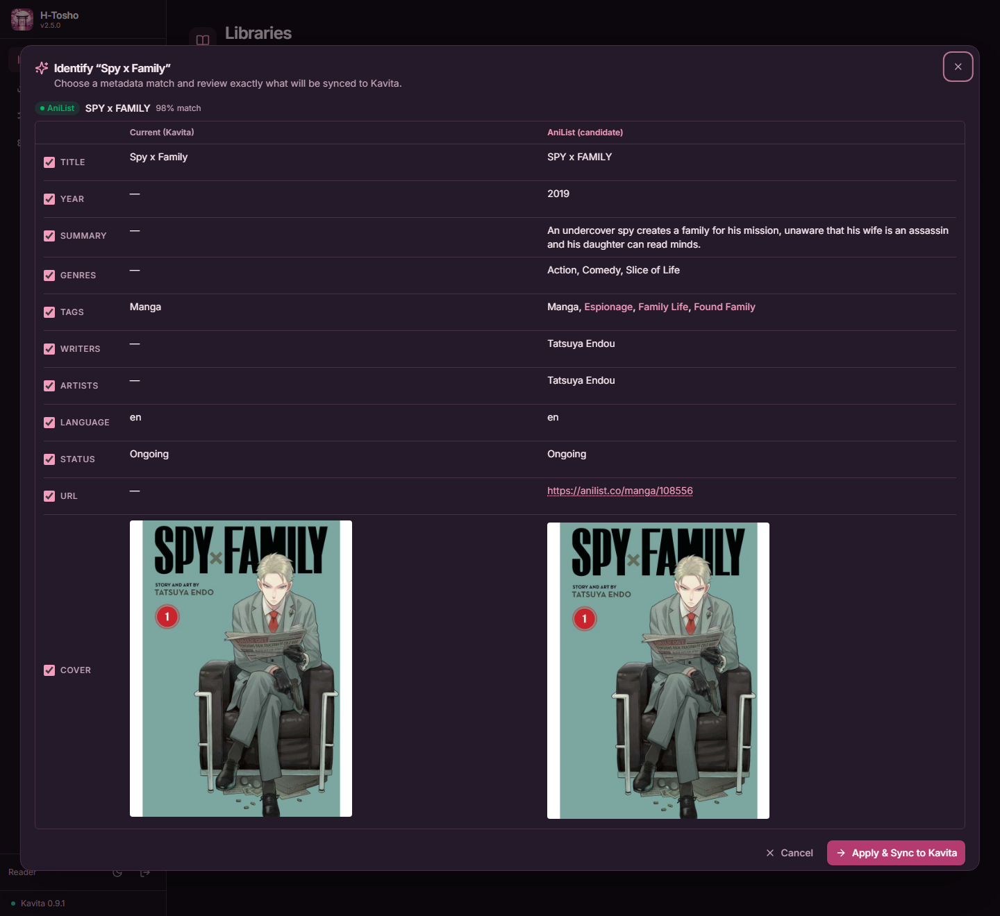

# H-Tosho

**Give your Kavita library better titles, descriptions, tags, and covers.**

H-Tosho helps you identify manga and light novels, review metadata before applying
it, and keep new additions organized. It also includes a doujinshi downloader,
recommendations, and watched searches for new releases.

Works with **Kavita v0.9.x or newer**. Current version: **v4.4.0** ·
[Release notes](CHANGELOG.md)


_The actual interface with a sample library. Series, artists, covers, counts,
match results, and metadata are fictional examples.
[About these screenshots](docs/screenshots/README.md)._

[Install](#install) · [First setup](#first-setup) ·
[Use your library](#use-your-library) · [Discover and download](#discover-and-download) ·
[Help](#help)

## What you can do

- **Start from Home.** See daily recommendations, unreviewed saved-search results,
  galleries with metadata candidates, and recent matches and downloads in one place.
  Matching discovery runs daily and on demand with **Scan now**. **Review match**
  opens the normal metadata comparison before syncing. **No match found** remembers
  that provider candidate; a different candidate can appear after another scan.
- **Clean up your library.** Find a series through AniList, MangaDex, or
  MyAnimeList, compare it with your current Kavita metadata, and choose what to
  update.
- **Protect and restore metadata.** Keep selected fields out of provider sync,
  inspect recorded updates, and explicitly review selected metadata, archive fields
  or retained cover images before restoring them.
- **Find matches through the artist.** In a matching dialog, choose **Browse artist
  works** to search AniList, MangaDex, or MyAnimeList by artist name or artist-page
  URL. Saved artists are filled in when available. Browse each provider’s works
  and select one to review before using **Apply & Sync**. MyAnimeList artist
  browsing reads public MAL pages; metadata review uses MAL’s API and needs a Client ID.
- **Keep new series organized.** Enable automatic matching and review uncertain
  results in **Needs review**.
- **Hear when a matched source changes.** A weekly check re-reads each matched
  series from the exact entry it is matched to and lists changes (new volumes,
  status, tags, covers) on Home for review. It never suggests a different match.
- **Discover and download doujinshi.** Search Hitomi.la, nHentai, or your
  own E-Hentai/ExHentai account — one at a time or together in **Unified
  search**, which groups the same work found on several sources — preview
  galleries, and save them as CBZ files or image folders.
- **Follow artists and searches.** Save a query and see new finds in
  **Recently added**, with in-app-only or immediate Discord notifications.
  **Suggested follows** lists artists you keep downloading but don't follow yet.
- **Get recommendations you can tune.** Ask for more like a gallery, mute an
  artist, or dismiss a pick you do not want.
- **Review possible duplicate downloads.** Compare galleries across Hitomi and
  nHentai with owned downloads and local CBZ metadata before downloading.
  Uncensored and decensored editions of galleries you own are marked
  **Better edition**.
- **Fix files and organize series.** Edit ComicInfo.xml inside CBZ files and
  merge related series.

## Install

### Docker

Install Docker with Docker Compose, then download
[`docker-compose.yml`](docker-compose.yml) into a new folder and start H-Tosho:

```bash
mkdir h-tosho && cd h-tosho
curl -fsSLO https://raw.githubusercontent.com/hiranaka99/H-Tosho/main/docker-compose.yml
docker compose up -d
```

This runs the prebuilt image `ghcr.io/hiranaka99/h-tosho`, published for
**linux/amd64** with every release. On other platforms, such as ARM, or to run
your own changes, clone the repository instead, uncomment `build: .` in
`docker-compose.yml`, and start with `docker compose up -d --build`.

Open **http://localhost:8787**. If Docker runs on another machine, use that
machine's address with port `8787`.

Your account, settings, and history are saved in the `h-tosho-data` volume.
Keep this volume when updating or recreating the container.

If you want to download galleries or edit existing CBZ files, also set up the
[library folders](#make-your-library-folders-accessible) below.

### Without Docker

Install **Node.js 26.13.1 or newer**, download or clone the repository, and run these
commands from its folder:

```bash
npm install
npm start
```

Open **http://localhost:8787**. App data is saved in `server/data` by default;
`HTOSHO_DATA_DIR` lets you choose another location.

## First setup

1. **Create your H-Tosho account.** Choose a username and a password of at least
   eight characters. You will use this account to sign in to this installation.
2. **Connect Kavita.** Create an Auth Key for a Kavita admin account under
   **User Settings → Manage Auth Keys**. In H-Tosho, open
   **Settings → General → Kavita connection**, enter your Kavita address
   without `/api` and the Auth Key, then choose **Save & test connection**.
   The sidebar shows the connection status.
3. **Choose your metadata sources.** Open **Settings → Providers**. AniList and
   MangaDex work without credentials. MyAnimeList needs a Client ID. Enable the
   sources you want and arrange their search order.
4. **Open Libraries.** Select a library and click a series to identify it.

For Docker, the Kavita address must be reachable **from the H-Tosho container**.
Use a hostname such as `http://kavita:5000` when both containers share a Docker
network, or your Kavita server's network address. `localhost` inside the
H-Tosho container refers to H-Tosho itself.

Matches, approvals, sync history, library overrides, and library jobs are saved
separately for each Kavita server address. Switching back to a saved address
restores its data; changing an Auth Key keeps the same data. Finish or cancel
active library jobs and downloads before changing servers.

### Make your library folders accessible

Metadata matching uses your Kavita connection. Renaming series through their
CBZ metadata, editing ComicInfo.xml, and moving or merging files also need
access to the library folders with write permission.

For Docker, add your folders to the `volumes` list in `docker-compose.yml`:

```yaml
volumes:
  - h-tosho-data:/data
  - /srv/books/manga:/mnt/manga
  - /srv/books/doujinshi:/mnt/downloads
```

Replace the paths on the left with folders on your Docker host. Restart with
`docker compose up -d`, then open
**Settings → General → Kavita library folders**. Map each Kavita folder to the
same folder as H-Tosho sees it:

| Folder shown by Kavita | Folder available to H-Tosho |
| ---------------------- | --------------------------- |
| `/media/Manga`         | `/mnt/manga`                |
| `/media/Doujinshi`     | `/mnt/downloads`            |

Choose **Save folders**. Leave a mapping empty if Kavita's path is already
accessible from H-Tosho. Map every root you need when a library has several
folders.

For new downloads, set **Settings → Downloader → Output folder** to
`/mnt/downloads` and make sure Kavita also has a library pointed at that shared
folder. Completed downloads are imported into Kavita and checked for metadata
candidates in background jobs. Review discovered matches on **Home** before using
**Apply & Sync**. This runs automatically, including when automatic library
matching is disabled; download completion does not apply metadata matches.

Prefer app data and downloads in local folders? The included
[bind-mount example](docker-compose.example.yml) uses `./data` and `./downloads`.
Download it next to `docker-compose.yml` and start it with:

```bash
docker compose -f docker-compose.example.yml up -d
```

With this example, use `/mnt/downloads` as H-Tosho's output folder.

## Use your library

### Identify a series and review the changes

1. Open **Libraries**, choose a library, and click a series cover or title to
   identify it or review metadata. **Preview pages**, to the right of the artist,
   opens the book separately.
   In library and Discover previews, click the right half of the page to go
   forward or the left half to go back. Arrow keys and page controls also work.
2. Existing matches open directly in the comparison. Use **Back to matches**
   to select another candidate.
3. Uncheck any fields you want to keep, and choose a title if alternatives are
   offered.
4. Choose **Apply & Sync**. H-Tosho applies your selection in the background;
   **Tasks** shows its progress and any warnings.



_Review the title, description, creators, tags, and cover before applying them.
This preview uses sample metadata and generated cover art._

If the suggested match is wrong, paste the series' AniList, MangaDex, or
MyAnimeList URL under **Use a provider URL** and choose **Load**.
Provider search diagnostics are expandable below the matches. Sync progress
and warnings are available in **Tasks**.
Use **Back to matches** to compare another candidate; your provider filter and
list position are preserved. Applying stays disabled until both current and
proposed metadata are available. Failed requests offer a retry.
The comparison footer keeps the selected-field count and apply action visible
while you scroll. A match records identification, not whether metadata is up to
date; the retired alignment status is no longer calculated or stored.

Applied series and volume covers are locked in Kavita so later scans keep them.
In the metadata comparison, expand **Protected from H-Tosho sync** to protect
individual fields across future provider updates. Changes save immediately.
Protected titles also skip CBZ title rewrites; cover protection includes volume
covers. Unmatch retains protected values. Unlock a field before syncing it;
deliberate edits in the ComicInfo editor remain allowed.

Merge dialogs load **Current protection** for indexed source and target series.
Review affected title changes and inherited locks before queueing; a protected
title change requires explicit unlock and a refreshed review. Source/target
protection is retained on the verified merged series, including a new numeric ID
or an interrupted merge recovered after restart. Paths and client IDs alone are
not authority to bypass protection. This preserves policies, not whole-merge undo.
The ComicInfo editor shows protection scope but still permits deliberate authoring;
series-associated edits retain protection and enter metadata history.

Expand **Metadata history** in the comparison dialog to browse saved updates,
including before/observed-after values, native Kavita locks, and captured archive
field changes. History covers provider updates, unmatch, series-associated
ComicInfo edits, merges into an existing series, and selective restores.
Choose **Before** or **After (observed)**, select available scalar/list fields,
then use **Preview restore** to compare current and saved values. Confirm the
review before **Queue restore**; **Tasks** reports the verified result. Restores
replace selected lists exactly, including empty tags/contributors and empty text,
without fetching the original provider, changing identification, or downloading.
Protected fields require an explicit unlock and a refreshed preview. Native
Kavita locks are preserved unless their captured flags are explicitly selected.
Provider **Apply & Sync** and Unmatch are disabled while Metadata history is open;
close history before returning to those separate mutation workflows.
Previews expire after 15 minutes; confirmed plans and their snapshots remain
pinned through queue delays. New selected edits, protection changes, or changed
series/installation identity require a new review. External Kavita clients cannot
be guarded atomically: fresh reads and readback verification are best effort.
Interrupted or partially applied restores remain inspectable and cannot be
retried blindly; review current values and create a fresh preview instead.
Snapshots are retained for 180 days plus the latest 20 finished updates per
series, independently of Task/activity cleanup. Earlier activity, path-only edits,
and newly created merge targets have no snapshots. Null/absent Kavita fields and
values Kavita normalizes or ignores are shown as unsupported rather than coerced
into empty values. Retained cover images use the separately reviewed API workflow below.

Title restoration updates **ComicInfo.Series in every indexed CBZ** before the
Kavita title. It requires complete agreement between Kavita's file index and the
readable series folder, configured library mappings, and supported native locks.
It preserves current sort/localized names and their locks. Missing files,
unsupported formats, changed file fingerprints, or incomplete indexing block
the restore and require a fresh review.

Expand a file under **ComicInfo.xml to restore** to select individual recorded
fields. Other current XML, including root attributes, comments and nested page
metadata, is preserved. **Replace complete ComicInfo.xml** explicitly replaces
the entire document, or removes the ZIP entry if it was originally absent;
grouping conflicts block this action. Archive restores require content identity
captured by this version: older snapshots remain browseable but cannot authorize
an XML restore. Moves and whole merges are not reversed. XML-only changes reach
Kavita on its next library scan; restoration does not start a scan or a download.

### Cover history and restoration

**Cover history** retains original series and volume image bytes served by Kavita
before and after provider cover updates and unmatch. To enable capture, choose a
storage budget with the server/container environment variable
`HTOSHO_COVER_HISTORY_LIMIT_MIB` (an integer from 10 through 16384), then restart
H-Tosho. For example, add `HTOSHO_COVER_HISTORY_LIMIT_MIB=256` to your Compose
service's `environment` list for a 256 MiB image budget. Capture is off until an
explicit budget is configured; existing cover updates continue to work.

With capture enabled, a failed required image read, stale image/identity, or full
budget prevents the affected cover write. Missing native series locks also block
capture; unavailable volume-lock flags are recorded as unknown, never inferred.
Provider updates can still apply other eligible metadata; unmatch prepares its
required cover backups before cleanup writes. History distinguishes absent images,
failed capture, and unavailable readback, and retains observations after partial
failure or cancellation. Protected series and volume covers are neither read nor changed.

Images are deduplicated in the persistent database and follow the history
retention policy. Each image is limited to 5 MiB; capacity for a 5 MiB readback is
reserved before a cover write. Retained or pinned images are never evicted to
admit new ones. Raise the configured budget and restart before retrying a write
blocked by capacity. The limit counts image payloads and reservations, with
additional disk space needed for SQLite bookkeeping and its write-ahead log.
Review capacity against your library before enabling capture widely.

Select retained series or volume images under **Retained cover images to restore**,
then use **Preview restore** to compare **Current** with **Saved image to upload**.
Explicitly accept Kavita's image conversion and the reviewed native-lock choices
before **Queue restore**. Kavita may resize/re-encode the original backup using
its current cover settings: this is **not byte-exact restoration**. The original
backup remains retained; the actual output and available native flags are journaled.

Native locks are preserved by default when readable, or can be restored from the
snapshot or explicitly set. If Kavita does not expose a volume's native lock,
choose **Apply Locked explicitly** or **Apply Unlocked explicitly** and refresh.
The API acknowledgement is recorded separately from independent lock readback.
Absent, missing or unverified image snapshots cannot authorize an upload. Earlier
operations have no invented backups. Browsing and restoring covers never start
downloads or scans; changed images, membership, protection or identity require fresh review.

### Match new additions automatically

Open **Library actions** to turn on **Auto-match new series** for the libraries
you want to monitor, refresh from Kavita, or **Match all unmatched**.
Set the check frequency under **Settings → General → Auto-scan interval**.
Refresh and matching actions show when they are queuing, then display library
job progress on the page, including on mobile. Choose **View job** for details.

Unconfirmed matches below 80% confidence appear in **Needs review**. Choose
**Start review** to work through the filtered queue. **Apply & next** queues the
selected changes and opens the next series; **Skip to next** leaves it unchanged.
The queue position stays visible, and closing returns you to the library list.

Libraries defaults to **Sort · Date added**, showing the newest series first.
Your selected sort order is remembered for the current browser session.

The Libraries search field matches series titles, artists, and saved tags.
Use `tag:romance` to search tags only, or `tag:"slice of life"` for a multiword
tag. Matching is case-insensitive and supports partial tag names. Tag searches
work with the match-status filter and across all result pages. Tags come from
Kavita metadata; stored match tags are used if that metadata is unavailable.

### Provider updates for matched series

H-Tosho re-reads every matched series from the exact provider entry it is
matched to, every 7 days by default. Change the interval or turn it off under
**Settings → Kavita → Auto-scan interval → Days between provider update
checks**, or choose **Check matched series now**. Only changes to that entry
are reported; a different or better candidate is never suggested here, and
nothing is applied automatically.

Changes appear under **Provider updates** on Home, for example a new status,
added tags or genres, a new description, cover or volume covers. Protected
fields, values the provider stopped returning, and a title you picked from the
provider's alternatives are not reported. **Review update** opens the normal
comparison on the same match; after **Apply & Sync** the update disappears.
**Dismiss** hides that provider state until it changes again. When Discord is
enabled, each new provider state is announced once.

### Check for duplicate galleries

Search, For you, and Following cards check the local library before download.
Merged chapters keep their own identity even when their series is renamed:
ComicInfo source links and gallery IDs in filenames show **In library**, while
title/artist matches offer **Review duplicate**. Clearing download history does
not remove these matches.

Downloads and merge downloads compare normalized titles (including alternate
source titles), artists, language, and page counts. Matching copies appear in
**Possible duplicates** with their source and file location. Choose **Cancel**
to keep your current selection or **Download anyway** to continue with the
selected gallery. Same-source galleries already owned or queued retain their
existing duplicate guard.

Local checks read ComicInfo metadata from CBZ files in the output folder, mapped
library folders, and library paths learned when you open Libraries. You do not
need Kavita to be online during a download. Archive metadata is cached and
rechecked periodically; unreadable folders and archives without title/artist
metadata are reported as incomplete coverage.
Incomplete coverage alone does not interrupt downloads; duplicate matches still
require review before proceeding.

A gallery whose title or tags mark it uncensored or decensored, and that matches
a gallery you own whose copy is censored or not marked either way, shows
**Better edition** instead of a duplicate warning. This also applies to a
decensored upload on the same source. Downloading it still opens a review
(**Download better edition**); your existing copy is never replaced or
deleted. Following finds that are better editions are counted on Home and
called out in Discord notifications.

These are metadata matches, not image comparisons. Known differences in language
or page count stay separate; missing metadata, unrelated source title variants,
and archives without usable ComicInfo may prevent a match. Detection metadata
persists independently of cleared download history.

### Edit metadata or merge series

Open a series card's **⋮** menu and choose **Edit ComicInfo.xml** to edit its
CBZ metadata through grouped fields. Saving preserves nested metadata and
attributes. Language name and language code are separate metadata fields.

Use **Change archive** to switch files without losing their unsaved drafts.
Closing with unsaved edits asks before discarding them. **Queue save** submits a
background write; follow the displayed job reference to check completion. The
archive name and save action remain visible while scrolling.

To combine related series, choose **Select to merge**, select the ones to combine,
and use the merge action. On phones, sorting and selection are under
**Sort & merge**. H-Tosho needs writable access to their files.

<details>
<summary>See the mobile interface</summary>

<p>The same library tools are available on a phone, with navigation in the menu.</p>


</details>

## Discover and download

Open **Discover** to access five tabs:

| Tab                | What to do here                                                                                                                                                                                             |
| ------------------ | ----------------------------------------------------------------------------------------------------------------------------------------------------------------------------------------------------------- |
| **Search**         | Search Hitomi.la or nHentai by keyword, tag, artist, or gallery ID. Preview a result, then download it or select several.                                                                                   |
| **Unified search** | Run one query across Hitomi.la, nHentai, and E-Hentai/ExHentai at once. Repeated editions appear once with every real source listed; a failed source leaves the others visible and offers a one-time retry. |
| **For you**        | Browse up to twelve picks, select the Kavita libraries that inform your preferences, and use **Refresh picks** for another set.                                                                             |
| **Following**      | Manage saved searches and browse new finds in **Recently added**.                                                                                                                                           |
| **Downloads**      | Track progress, pause or resume downloads, retry failures, and view completed downloads.                                                                                                                    |

Before downloading, open **Settings → Downloader** and choose your output
folder and format. **CBZ** puts each gallery in an archive; **Folder** saves its
images in a directory. You can also set download concurrency, excluded tags,
an optional nHentai API key, and your own E-Hentai/ExHentai account: paste the
`ipb_member_id` and `ipb_pass_hash` cookies from a logged-in browser session
and choose the site to use (E-Hentai or ExHentai). Those cookies stay
encrypted on the server and are never sent to the browser. Discover shows the
current folder and format, and offers **Set output folder** before you can
queue your first download.

Switching sources translates the current query into the other provider's syntax,
preserving shared artist/group/parody/character/language filters and exclusions.
Compatible committed searches run automatically; unfinished drafts stay drafts.
Filters or sort modes without an equivalent are listed beside the translated
query for review before searching. Catalog IDs and URLs cannot transfer across
providers. Switching back without editing restores the exact original query,
including unsupported filters. The watched-query source selector uses the same
translation rules. Both providers retain their English default.

Hitomi search uses the website's query syntax: spaces combine required terms,
`OR` combines alternatives, `-artist:sample` excludes a term, and underscores
represent spaces inside tags (`artist:sample_name`). Queries default to English
unless they specify `language:`; image sets remain excluded. Sorting supports
date added, date published, random order, and popularity today/week/month/year.
Typed `orderby:`, `orderbykey:`, and `orderbydirection:` directives also work.
Results load 25 galleries per page with the full filtered count, so searches can
be browsed beyond 1000 matches. Selections remain available across pages.

nHentai also defaults to English unless a positive `language:` or `languages:`
filter specifies another language. Its native query syntax passes through:
quoted phrases, `-tag:"full color"`, `artist:"sample name"`, `pages:>20`,
`favorites:>=100`, and `uploaded:<7d`. Plural namespaces such as `artists:` and
`parodies:` are supported. Autocomplete follows the typed tag namespace and
retains exclusions. The website's newest and popular all-time/week/today sorts
are available. nHentai results use native pages with the full matching count,
replacing the old 250-result browsing limit.

**Unified search** runs one query on all three sources at once. The shared
syntax — `artist:`, `group:`, `parody:`, `character:`, `language:` filters,
quoted phrases, `-` exclusions, and plain keywords — is compiled into each
provider's native syntax; a filter a source does not support is reported on
that source's status chip while the search still runs on the other sources.
Results load 25 unique entries at a time with **Load more**. When the same
work (same title, first artist, language, and page count) appears on several
sources it shows once, with an **Also on** badge on the card and an
**Available from** list in the details view; choosing a variant re-targets
the preview, source link, and download at that concrete gallery. If a source
fails, the others' results stay visible and a one-time **Retry** re-runs only
the failed source. E-Hentai/ExHentai is searched only when an account is
saved, and saving a different account or changing downloader settings
invalidates an in-flight unified search, which then asks you to start again.

H-Tosho prevents duplicate queued downloads and remembers galleries downloaded
through the app. To remove unwanted recommendations, open a card's **Tune
recommendations** menu and choose **Don’t recommend this gallery**. Use **Undo**
to restore a dismissed gallery.

### Tune your recommendations

The server prepares and saves daily recommendations in the background, even
when the app is closed. It checks at startup and every minute, generating picks
once per day using the server's local date. Opening the app reuses the saved
picks. If the server was offline, it catches up when started; the first opening
may wait if preparation is still running. An already open app keeps its displayed
picks until reopened or you choose **Refresh picks**. Switching pages, downloads,
and preference changes do not roll a new set.
Returning to Discover restores the last tab you used, including For you.

Use a card's **Tune recommendations** menu to choose **More like this**, dismiss
the gallery, or mute an artist. More like this influences the next refresh; a mute immediately hides
recommendations featuring that artist, including collaborations.

The **Feedback** button beside **Refresh picks** lets you undo saved preferences
or unmute artists. Use thumbs down to dismiss a single gallery, and
**Dismissed galleries** to undo dismissals. These choices survive restarts.

### Watch for new releases

Run a search, then choose **Watch** to save that query. Under **Following**,
**Check now** checks active watches. Automatic checks follow the **Check every**
setting; paused watches are excluded.

**Suggested follows**, below the Following feed, lists artists credited on at
least two galleries you downloaded (a **More like this** pick counts double)
that no watch covers yet. **Follow** adds a normal watch named after the
artist on the source most of their galleries came from; its first check is
silent. The **×** button stops suggesting that artist. Muted artists are never
suggested.

Watch controls stay above the feed. **Manage watches** opens saved searches and
the add form. Check progress and outcomes remain visible, with a link to the job.
The query field offers the same tag and artist autocomplete as Search; choose
a suggestion with the pointer or arrow keys and Enter, then select Add watch.

Use **Edit** to give a watch a readable name, move it into a folder, or choose a
cadence: inherit **Check every**, or select 15 minutes, 1 hour, 6 hours, or daily.
Setting the global **Check every** control to **Off** disables automatic checks
even for watches with a custom cadence. Pause/resume and organization changes
preserve seen galleries and review history. Changing the source or query means
adding a new watch, not renaming the existing one.

Use **Notification delivery** in each watch's editor to choose **In-app only**
or **Immediate Discord**. Discord requires global enablement. Existing digest
watches switch to immediate notifications for future finds when upgrading; old
notification backlog is not replayed.

Folders can be renamed, reordered, and deleted. Deleting a folder moves its
watches to **Unfiled**; it does not remove discoveries. Each watch shows its last
successful check, last failed attempt, effective cadence and next due time.
Due times persist through restart, and bounded sweeps select at most 20 watches
every 15 seconds. Checks inspect up to 50 provider results, not a complete
catch-up after a long pause.

The first check records existing results quietly. Later checks save finds to
**Inbox** and send eligible Discord notifications during the check Task.
Overlapping watches notify once per gallery and source. Confirmed sends and
notification errors are recorded in **Tasks**, separately from provider failures.
Results with a known upload date older than fourteen days are skipped to avoid
stale announcements. Results without a usable upload date remain eligible.

Watches find galleries for you; choose the ones you want to download from the
feed. Filter discoveries by folder, watch or source. Folder filters use current
membership before gallery deduplication; removed watches remain under **Unfiled /
removed watches**, with their readable name and original query retained.
If a watch no longer belongs to the selected folder, its exact-watch filter
clears to **All watches** and restarts at the first page.
**Dismiss**, next to Download, removes a find from Inbox while keeping it in
**History**; **Return to inbox** reverses that choice. Review state is saved
across sessions and shared by watches that found the same gallery. Stopping a
watch keeps its discoveries in Inbox and History.

Artist and language are saved from search results when available. Older finds
gain that context when later checks return metadata for them. **Select galleries**
supports downloading together, merging, and dismissing selected finds.

### Enable Discord notifications

Open **Settings → Notifications**, enable Discord, paste your channel's webhook
URL, save, and send a test message. Notifications include automatic metadata
matches and updates, plus new watched-search results. Manual **Apply & Sync**
does not send Discord notifications; results and warnings remain in **Tasks**.

Watched-search notifications are immediate. Changing preferences or enabling
Discord does not replay old finds. Check results and Discord send outcomes remain
in the normal **Tasks** history and logs. Following does not maintain a separate
delivery log, daily digest, or notification retry queue. Notifications never
download galleries.

## Help

| Problem                                                | What to check                                                                                                                                                                                                                 |
| ------------------------------------------------------ | ----------------------------------------------------------------------------------------------------------------------------------------------------------------------------------------------------------------------------- |
| **Kavita will not connect**                            | Test the connection in Settings. Check the server address and admin Auth Key. In Docker, use an address reachable from the container.                                                                                         |
| **A title will not change, or a CBZ cannot be edited** | Check write permissions and **Kavita library folders**. The mapped path must point to the same files Kavita uses. Open the job for the specific warning.                                                                      |
| **The cover has not updated**                          | Wait for **Apply & Sync** to finish. Check **Tasks** for cover-upload errors, then refresh the library.                                                                                                                       |
| **A download failed**                                  | Open **Downloads → Needs attention** for the error. Check the output folder and source settings, then retry. An nHentai API key can help with rate limits.                                                                    |
| **A unified search shows a source as failed**          | The other sources' results stay usable. Use that source's one-time **Retry**; for E-Hentai/ExHentai, re-test or re-save the account in Settings → Downloader. Saving a different account restarts in-flight unified searches. |
| **A watch has no new results**                         | Its first check is silent. Check the saved query and interval, or use **Check now**. Old uploads are suppressed when their date is known.                                                                                     |

**Tasks** contains the results and logs for scans, matches, merges, edits, and
watched-search checks. Failed jobs offer retry and, where available, a link to
the relevant setting. Clearing failed-job history removes its logs, not library
files.

### Update and back up

H-Tosho can check for new GitHub releases and update itself from **Settings → Account → App updates** (a notice also appears in the sidebar when a newer version is available):

- **Git checkout (source install):** fetches the release tag, runs `npm ci` (or `npm install`) and `npm run build`, and restarts H-Tosho automatically. The working tree must be clean and active tasks/downloads must be idle.
- **Docker:** when only application code changed (same `Dockerfile`, Node.js requirement, and server runtime dependencies), H-Tosho downloads the verified release bundle into `/data/updates` and restarts automatically, rolling back to the base image if startup fails. Whenever a release changes the `Dockerfile`, Node.js requirement, or server runtime/native dependencies — or ships without a compatible bundle — H-Tosho warns that the **Docker image must be completely replaced**, lists the exact reasons, and provides copyable commands.

To update a Docker installation manually (or when an image replacement is required):

```bash
# Prebuilt image
docker compose pull && docker compose up -d

# Local Git checkout with `build: .` enabled
git pull
docker compose up -d --build
```

If you use the bind-mount example, include `-f docker-compose.example.yml` in
the Compose command. For a source installation, stop the app, update the
checkout, run `npm install`, and restart with `npm start`.

Back up your app data and library folders. Stop H-Tosho before copying its data
folder or Docker volume for a consistent backup. Keep the existing data volume
when upgrading; do not use `docker compose down -v` unless you intend to erase
the saved app data.

### Access from another device

The included Docker configuration exposes port `8787` on the host. A source
installation listens on `127.0.0.1` by default; set `HOST=0.0.0.0` when you want
to reach it over your network. Sign in with your H-Tosho account on each device.

Found a problem? [Open an issue](https://github.com/hiranaka99/H-Tosho/issues)
with your H-Tosho version, what you expected, and the relevant job error. Remove
passwords, Auth Keys, and webhook URLs from anything you share. Report security
vulnerabilities privately instead, as described in [SECURITY.md](SECURITY.md).

## Disclaimer

H-Tosho is self-hosted software. It does not host, mirror, or distribute any
content; it only connects to the services you configure. Some supported sources
contain adult material. Use H-Tosho only where you are of legal age and where
that content is lawful. You are responsible for following each site's terms of
service and the copyright laws that apply to you.

H-Tosho is an independent project and is not affiliated with Kavita, AniList,
MangaDex, MyAnimeList, E-Hentai, nHentai, or Hitomi.la.

## Development checks

Use `npm ci` to install the versions in the lockfile. Run `npm run typecheck`
and `npm test` to check both workspaces. `npm run build` produces the frontend,
backend, and precompressed Brotli/gzip assets used by the production server.

Keep `npm run dev` running while editing. Vite hot-replaces frontend modules and
styles; the backend automatically reloads changed source files and applies
pending migrations at startup. Source changes do not require a build or a manual
dev-server restart.

For desktop and mobile browser checks, install Chromium once with
`npm exec --workspace @h-tosho/web -- playwright install chromium`, then run
`npm run test:e2e`. This builds the app and starts an isolated server with a
fresh temporary database, without download workers or scheduled jobs.
`npm run screenshots` regenerates the README screenshots in `docs/screenshots`
from the same isolated server, using fictional sample series and covers.

## Publishing Docker images

The [Docker release workflow](.github/workflows/docker-release.yml) builds the
release's tagged commit and publishes a Linux AMD64 image to the GitHub Container
Registry as `ghcr.io/<owner>/h-tosho` whenever a GitHub release is **published**.
Commit and push the workflow before publishing the next release; pushing a tag
alone or saving a draft release does not trigger it.

The workflow signs in with the built-in `GITHUB_TOKEN`, so it needs no repository
secrets. The first push creates the package as private; change its visibility
under the package's **Package settings** if others should be able to pull it.
A stable release tagged `v2.14.0`, for example, publishes `v2.14.0`, `2.14.0`,
and `latest`. Prereleases publish their version tags without updating `latest`.
Build progress and failures appear in the repository's **Actions** tab.

## License

H-Tosho is released under the [MIT License](LICENSE).
