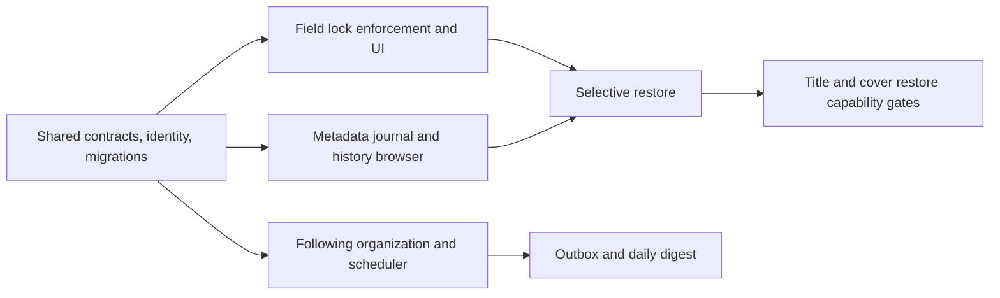

# H-Tosho feature implementation plan

Date: 17 November 2026
Status: All three features implemented and verified within the supported boundaries documented below.

### Implementation progress

- **Metadata field locks completed:** connection-scoped, revisioned protection and comparison controls; execution-time enforcement before provider title/archive/covers, unmatch and every library/path/gallery merge publication. Source/target policy unions survive verified regrouping, new numeric IDs, interrupted moves and late indexing. Merge preflight requires explicit title unlock/refreshed review; server-derived identity/policy/move evidence lives in execution state, not client commands. Manual ComicInfo authoring remains allowed, explains protection and retains/journals associated edits.
- **Second increment implemented (H1 / P2):** connection-scoped durable before/observed-after snapshots for provider apply/sync, unmatch, series-associated ComicInfo edits, and merges into an existing series. Original ComicInfo XML, presence and file fingerprints are saved before archive mutations. The comparison dialog includes a paginated **Metadata history** viewer with metadata/native-lock and archive-field comparisons, plus loading, empty and retry states. Capture starts with this version; earlier summary activity cannot be restored.
- **Third increment implemented (H2 / P3 scalar/list):** exact selective restoration from retained Before/verified After snapshots, field/native-lock availability, Current → Restore to previews, explicit review, protected-field unlock/refresh, idempotent durable approved plans, and linked restore Tasks/history. Selected values and native flags, policy revision, connection and series/path/installation evidence are rechecked at execution. Approved snapshots remain pinned through ordinary queue delays; interrupted/partial restores require a fresh preview rather than blind replay.
- **Recovery and retention:** required before reads fail closed; uncertain readback and silent remote no-ops are marked unverified; exceptions/cancellation retain observed results; restart marks unfinished entries interrupted. Startup pruning retains 180 days plus the latest 20 finalized operations per connection/series and always retains running operations, independently of activity and Task cleanup. Each operation allows up to 2,000 archives and 16 MiB of XML per snapshot side.
- **Fourth increment implemented (H3 / P3 title/archive):** paired historical/custom title restoration across a complete indexed CBZ file set; exact selected XML fields with unrelated current XML preserved; explicitly reviewed complete-document replacement or ZIP-entry removal. Current allowed library roots/mappings, indexed/on-disk membership, complete-file/content hashes, file identity and fingerprints are rechecked under archive ownership. Approved archive plans survive queue delays; preparation/publication/readback checkpoints remain inspectable after failure, cancellation and restart. Sort/localized names and flags remain recorded; the title writer preserves unlocked sort names through Kavita's rename behavior. Tasks report verified archive counts separately from metadata fields.
- **Fifth increment implemented (H4 / series and volume covers):** opt-in original series/volume-cover bytes, available native locks and indexed identity before/observed-after provider updates, unmatch and supported-API restoration. Authenticated comparison images distinguish retry, absent and unverified states. Content-hash deduplication, bounded streaming, reserved readback capacity, retention GC and separate-process restart preserve original backups. Migrations 8/13 add checkpoints and approved image plans without inventing older history. Capture requires `HTOSHO_COVER_HISTORY_LIMIT_MIB` (10–16384 MiB); unset preserves existing cover updates with explicit not-captured history. Images and readback reservations are each limited to 5 MiB; the 256 MiB reference budget remains an operator decision excluding SQLite/WAL overhead.
- **Approved image-restore contract:** use Kavita's supported series/volume upload API with explicit review of [thumbnail resizing/re-encoding](https://github.com/Kareadita/Kavita/blob/develop/Kavita.Services/ImageService.cs), not a byte-preserving claim or direct Kavita filesystem/database writes. Preview current/saved images, native-lock choices and later changes; require conversion consent at approval. Retain originals and journal actual output. Missing native volume-lock readback requires explicit Locked/Unlocked selection; API acknowledgement is not independent flag verification. Recheck protection, image/native-lock fingerprints, installation and indexed identity before upload; pin source/current assets through queue delays. Absent/missing/unverified images remain unavailable.
- **Current limits:** no whole-merge undo, file-move reversal, or automatic restore retry/reconciliation. Earlier operations have no saved cover bytes. Title/archive restore requires fully indexed CBZ-only membership and accessible library mappings; symlinked contents, unreadable or unindexed files, unsupported XML and grouping conflicts block restoration. Older archive snapshots without content identity remain browseable but cannot authorize XML restore. Entry removal is supported only when grouping stays valid. Archive-only changes reach Kavita on its next library scan; restores do not start scans or downloads. Null/absent Kavita fields and historical values Kavita normalizes or ignores are visibly unavailable, not coerced (including release years below 1000). Path-only archive edits, edits without a configured Kavita connection, merges that create a new series, and source series removed by a merge do not have a series snapshot. Moved source archives retain their before XML; unavailable readback is explicitly unverified. External Kavita clients remain outside local mutation ownership; fresh read/merge/post and readback checks are best effort, not atomic conditional writes.
- **Validation (H2):** 592 server and 37 frontend unit tests passed, including exact writes, history, queue integration, fresh/upgrade migrations and retention. Production server/web builds and typechecks passed; 12/12 focused desktop/mobile protection/history/restore browser scenarios passed in light/dark themes, with 4/4 restore flows rerun after warning-contrast correction. Local compiled-server restart smoke preserved snapshots and required fresh review for interrupted restores. The full browser run passed 87/88; desktop Hitomi query handling failed at `web/test/e2e/app.spec.ts:417`, outside the restore flow. Container verification could not run because the Docker daemon was unavailable.
- **H3 validation:** 624 server tests and 37 frontend tests passed, including selected XML preservation, entry removal with ZIP extras/comments/attributes/data descriptors intact, same-size file changes, mount/index conflicts, protection, cumulative XML budgets, retention, remote no-ops/errors, native sort-lock preservation, cancellation and separate-process restart persistence. Production builds/typechecks and all 90 desktop/mobile browser scenarios passed. Title/archive selection, paired previews, XML replacement conflicts and archive-only Tasks were visually verified in both themes; the independent Impeccable review's Task-summary correction was scored resolved. Docker persistent-volume verification remains unavailable because the daemon is not running.
- **H4a validation:** 645 server tests, 37 frontend tests and all 92 desktop/mobile browser scenarios passed. Cover tests exercise original bytes/native locks, before-write enforcement, stale values and identity, active-connection asset authorization, absent versus unavailable images, admission limits, deduplication/GC, migration upgrades and separate-process restart. Production builds/typechecks and whitespace checks passed. Images, image-load retry, absence and unverified readback were visually checked on desktop/mobile in both themes; the independent Impeccable reviewer returned **ship** for the cover-history UI addition. The existing design system was preserved; pre-existing design-sidecar drift remains outside this increment. Docker persistent-volume verification remains unavailable because the daemon is not running.
- **Sixth increment implemented (F1 / Following organization and scheduling):** readable names and folders, revision-safe editing/reordering/removal, pause/resume, inherited or bounded custom cadence, targeted Check once and persisted bounded due-work sweeps. Global automatic-off overrides custom intervals; paused checks update in-app discoveries without Discord or resuming. Provider-response and dispatch-boundary rechecks discard obsolete pause/delete/edit work, while per-watch ownership prevents overlapping checks. Folder filtering precedes deduplication/paging, and removed-watch names/query provenance and shared review remain readable. Migration 10 defers new indexes until legacy duplicate reconciliation and preserves canonical IDs, seen sets, discovery metadata/review and legacy JSON finds.
- **F1 validation:** 106 focused server/runtime/migration/queued-executor tests passed, including separate-process restart; 10 existing and 2 new desktop/mobile Following browser scenarios passed. Production frontend/backend builds and typechecks passed. Genuine API/Task/DB browser flows cover revision conflicts and draft recovery, folder CRUD/reorder/filtering, silent seeding, provider failure/recovery, pause/custom/inherited cadence, global-off, retained removed-watch provenance, shared review and no acquisition requests. Editor, paused/provider-failure, removal and feed states were inspected in both themes and viewports; the Impeccable detector reported no findings. The existing `npm run dev` supervisor stayed running: frontend HMR preserved the page instance and source saves automatically reloaded the backend; no manual restart was required. Docker persistent-volume checks remain unavailable from the earlier increments and were not rerun.
- **F1 UI corrections:** late saves are scoped to their initiating editor instance; successful feed refreshes clear an exact-watch filter that no longer belongs to the selected folder; watch-search accessible labels contain the visible saved name. Genuine desktop/mobile regressions cover delayed-save draft preservation and folder movement with another eligible watch's retained discoveries, plus dynamic visible/accessibility-name agreement. The corrected frontend build/typecheck and complete focused browser flows passed; Chromium viewport bounds are normalized to 0.001 CSS-pixel precision while retaining the 44px touch-target threshold.
- **F1 UI finish review:** the independent reviewer scored all three material interaction/accessibility corrections **resolved** and returned **ship** at that fix-list scope. The established Following composition and light/dark design system were retained; DESIGN.md and its sidecar were not changed.
- **Seventh increment implemented (F2 / notifications and daily digest):** revisioned per-watch in-app/immediate/digest preferences, atomic discovery/outbox contributions, source/gallery deduplication and immutable daily batches. Separate dispatch records acknowledged, disabled, suppressed, failed and unknown outcomes; bounded known retries reuse membership and interrupted/ambiguous sends require duplicate-aware, current-destination review. Preference/settings changes cannot resurrect old backlog. Timezone-aware cutoffs persist in UTC with earlier DST fold and forward gap handling. Following and linked Tasks expose paginated delivery history/recovery; Settings exposes local time and IANA timezone. Migration 12 preserves existing histories without backfilling notifications; the Temporal dependency is server-only.
- **Completion validation:** 312 focused backend tests and 54 distinct desktop/mobile scenarios passed across the integrated runs, covering protection/merge publication and recovery, exact scalar/title/XML restoration, supported cover HTTP payloads/original retention/native-lock limits, transactional Following delivery and DST/ambiguous recovery. Production frontend/backend builds and their compiler checks passed. Final light/dark renders were inspected on desktop/mobile, including deliberate ComicInfo authoring and cover conversion consent. Separate-process restart checks preserved cover originals, approved plans, policies and unknown-delivery holds. Docker checks were not run in this increment; no claim of external atomic writes, byte-exact cover restoration or external exactly-once delivery is made.

## 1. Scope and product boundaries

Plan the following additions to the existing application:

1. Metadata field locks.
2. Metadata history and selective restore.
3. Better Following controls.

**Downloading stays manual.** Following checks, notifications, and restore operations must never enqueue gallery downloads. A user must choose a gallery and invoke the existing download action, including its setup and duplicate checks.

Keep the existing Home, Libraries, Discover, Tasks, and Settings navigation. Add contextual pages, panels, and actions rather than additional sidebar destinations. Preserve the current light/dark design system, keyboard behavior, 44px touch targets, and review-before-apply workflow.

**Required UI workflow:** Use the **Impeccable UI skill** for every new or modified UI element in this plan, including pages, components, dialogs, forms, navigation, controls, states, and interface copy. Read and follow the applicable Impeccable skill instructions before UI work, reuse the existing product/design context, and visually verify desktop/mobile and light/dark behavior as required by the skill. This requirement applies to every delivery increment; backend-only work does not require a UI skill pass.

This plan does not include a new reader, automatic file replacement, automatic metadata restoration, or unrelated Home changes from the earlier critique.

## 2. Existing architecture to build on

| Area                           | Current implementation                                                                                                                                                                                                                                                                                           | Consequence for this work                                                                                                                                                    |
| ------------------------------ | ---------------------------------------------------------------------------------------------------------------------------------------------------------------------------------------------------------------------------------------------------------------------------------------------------------------- | ---------------------------------------------------------------------------------------------------------------------------------------------------------------------------- |
| Metadata field selection       | [contracts/metadata.ts](../server/src/contracts/metadata.ts)                                                                                                                                                                                                                                                     | Reuse `SyncField` and `EXCLUDABLE_FIELDS`; keep persistent protection separate from one-operation exclusions.                                                                |
| Metadata application           | [services/sync.ts](../server/src/services/sync.ts)                                                                                                                                                                                                                                                               | Provider apply/sync paths converge here. `ComicInfo.Series` can be rewritten before the remote metadata update, so protection and snapshot capture must precede that branch. |
| Kavita writes                  | [kavita/client.ts](../server/src/kavita/client.ts), [kavita/types.ts](../server/src/kavita/types.ts)                                                                                                                                                                                                             | Metadata updates merge into a full DTO; cover and archive workflows require verified target identities.                                                                      |
| Archive writes and concurrency | [lib/cbz.ts](../server/src/lib/cbz.ts), [lib/mutations.ts](../server/src/lib/mutations.ts)                                                                                                                                                                                                                       | Preserve atomic archive publication and the existing series/archive mutation ownership.                                                                                      |
| Tasks                          | [contracts/jobs.ts](../server/src/contracts/jobs.ts), [jobs/queue.ts](../server/src/jobs/queue.ts), [jobs/executor.ts](../server/src/jobs/executor.ts)                                                                                                                                                           | Extend validated commands, execution state, conflict rules, cancellation, retry, and recovery together.                                                                      |
| Persistence                    | [db/schema.ts](../server/src/db/schema.ts), [db/migrations.ts](../server/src/db/migrations.ts), [db/index.ts](../server/src/db/index.ts)                                                                                                                                                                         | Add new numbered transactional migrations; existing-install upgrades cannot rely on bootstrap alone.                                                                         |
| Connection identity            | [services/kavitaState.ts](../server/src/services/kavitaState.ts)                                                                                                                                                                                                                                                 | Reuse `kavitaConnectionKey()`. New library-specific tables should carry their connection key explicitly.                                                                     |
| Following                      | [services/watchedSearches.ts](../server/src/services/watchedSearches.ts), [routes/api/watched.ts](../server/src/routes/api/watched.ts)                                                                                                                                                                           | Preserve silent first-check seeding, retained discoveries, shared review state, filtering, and paging.                                                                       |
| Notifications and scheduling   | [services/settings.ts](../server/src/services/settings.ts), [index.ts](../server/src/index.ts)                                                                                                                                                                                                                   | Replace the all-watches global timer with persisted due-work scheduling; separate source-check success from notification delivery.                                           |
| Existing artist identification | [contracts/artists.ts](../server/src/contracts/artists.ts), [ArtistWorksBrowser.tsx](../web/src/components/ArtistWorksBrowser.tsx)                                                                                                                                                                               | Metadata-provider artist identities remain part of metadata identification.                                                                                                  |
| Frontend integration           | [IdentifyModal.tsx](../web/src/components/IdentifyModal.tsx), [Libraries.tsx](../web/src/pages/Libraries.tsx), [WatchedSearchControls.tsx](../web/src/pages/downloader/WatchedSearchControls.tsx), [GalleryDetailModal.tsx](../web/src/pages/downloader/GalleryDetailModal.tsx), [api.ts](../web/src/lib/api.ts) | Extend established review, library, Following, and gallery flows rather than creating parallel versions.                                                                     |

### Important current limitations

- Kavita's native metadata locks are not H-Tosho protection: the current client deliberately unlocks selected fields, writes them, and locks them again.
- `sync_history` records action summaries, not authoritative before/after snapshots. It is pruned after 90 days; Tasks and logs are pruned after 30 days. Neither is a sufficient restore journal.
- The regular sync path adds tags and skips some empty contributor arrays. Exact restoration needs a distinct typed write path capable of clearing values.
- Following currently checks a bounded result window. A successful check does not prove that every release since the previous check was examined.
- Following commits discovery bookkeeping and notification intents atomically; delivery is separate. Discord acknowledgement cannot provide external exactly-once delivery, so uncertain outcomes remain held for reviewed recovery.
- Schema bootstrap currently rejects table-level foreign keys, checks, and composite primary keys. Use the existing unique-index pattern, or extend bootstrap deliberately with fresh-install and upgrade tests before introducing those constraints.

## 3. Shared implementation rules

### 3.1 Identity and ownership

- Scope locks, metadata operations and restore previews by `(connectionKey, seriesId)`, with library/series identity evidence captured where relevant.
- Derive the active connection on the server; a request must not select an arbitrary connection merely by supplying its key.
- Persist enqueue-time connection identity in new restore commands. Refuse execution against a different current connection. Continue the existing restriction on changing connections during active library mutations.
- If an installation identifier is available from Kavita, retain it as additional identity evidence. Treat a changed installation or conflicting library/path identity as a review-required condition; do not assume a reused numeric series ID means the same content.
- Keep Following preferences installation-wide, as current discovery state is.
- Keep native gallery identity as `(source, galleryId)`. Similar names, titles, and metadata are evidence for review, not permission to collapse distinct editions.
- Path-only archive edits may have no Kavita series identity. Do not attach them to whichever series/connection is currently open. Initial series history covers only edits with a resolved series association; expose other edits as outside restore coverage until a separate archive-identity history flow is implemented.

### 3.2 Contracts and execution

- Add pure shared contracts for field policy/history and Following preferences. Keep frontend imports free of server I/O.
- Reuse the existing authentication boundary and strict payload allowlists. Validate field names, numeric IDs, intervals, result limits, and source capabilities.
- Use optimistic revisions for editable policies/preferences and expected-state fingerprints for destructive or restorative writes. Return a clear conflict when a preview is stale.
- Recheck authoritative policy at execution time under the relevant mutation coordinator. A checkbox or a preview is not enforcement.
- Local SQLite commits, archive publication, and Kavita requests cannot form one distributed transaction. Journal preparation and checkpoints, verify outcomes, and represent partial/interrupted work honestly.
- H-Tosho's coordinator cannot serialize other Kavita clients. The current wrapper has no conditional-write/ETag support: full-DTO read/merge/post still has an external-edit race window. Read immediately before posting and verify afterward; describe these checks as best effort until supported conditional writes are validated, not an atomic guarantee against external edits.
- New read-only jobs need an explicit executor path. Read-only discovery checks must avoid exclusive library write ownership and unnecessary cache invalidations.

### 3.3 Migrations and compatibility

- Allocate the next unused migration versions when implementing each increment; do not modify an already-applied migration.
- Test both a fresh database and an upgrade containing existing matches, rejected candidates, history, watches, discoveries, and queued work.
- New directly scoped tables should remain in place across Kavita connection switches; do not add them to the legacy table-swapping mechanism unnecessarily.
- Keep old history readable, existing discovery URLs usable, and current download/duplicate behavior intact. Migration must not manufacture missing historical snapshots.

## 4. Metadata field locks

### 4.1 Behavior and first-release decisions

Label the feature **Protected from H-Tosho sync** so its scope is clear.

| Operation                                                | Policy                                                                                                                                                                                                                           |
| -------------------------------------------------------- | -------------------------------------------------------------------------------------------------------------------------------------------------------------------------------------------------------------------------------- |
| Automatic matching/sync and manual provider Apply & Sync | Skip protected fields, including their filesystem side effects. Apply eligible unprotected fields normally.                                                                                                                      |
| Unmatch cleanup                                          | Remove the identification link as requested, but retain protected metadata/covers and report what was retained.                                                                                                                  |
| Direct, explicit ComicInfo editing                       | Remains a deliberate authoring workflow. Show protection status, preserve the protection afterward, and record the edit in metadata history. Do not infer authorization to bypass protection from a generic background-job flag. |
| Metadata restore                                         | Protected fields are excluded until the user explicitly unlocks them and refreshes the restore preview. No silent override.                                                                                                      |
| Explicit merge/rename                                    | Show affected protected fields before queueing. Require explicit unlock for a protected target-title change; protection must not disappear because a series is merged.                                                           |

Initial keys are the existing `SyncField` values: title, summary, genres, tags, writers, artists, releaseDate, language, status, and url. Clarify that `releaseDate` currently represents the pushed release year and that the generic artist field maps to Kavita's pencillers.

Add a `cover` protection key covering **both series and volume cover updates** in the first release, matching the current single cover selection. Independent per-volume protection can be a later extension.

Changing provider candidates must not reset protection. Unlocking a field changes policy only; it does not immediately sync or restore anything.

### 4.2 Storage and API

Proposed `series_field_policies` table:

- `connection_key`, `series_id`, `locked_fields_json`, `revision`, `updated_at`.
- Unique index on `(connection_key, series_id)`.
- Store an empty protection list as a revisioned policy too, so clearing all locks does not reset concurrency detection.
- Validate stored and incoming keys against the shared field registry; do not store arbitrary DTO paths supplied by clients.

Proposed authenticated endpoints:

| Endpoint                      | Purpose                                                                          |
| ----------------------------- | -------------------------------------------------------------------------------- |
| `GET /series/:id/field-locks` | Return protected keys, policy revision, and protection scope.                    |
| `PUT /series/:id/field-locks` | Replace the validated key set using `expectedRevision`; return the new revision. |

The update operation must acquire the same series mutation ownership used by application. A successful lock-update acknowledgement establishes the boundary after which later operations must observe that policy; it does not retroactively cancel a write already committing.

### 4.3 Implementation tasks

- [x] Extend the shared registry with protection labels, exact payload mappings, and cover policy.
- [x] Implement a policy resolver returning requested, effective, and protected/skipped fields plus the current policy revision.
- [x] Apply that policy before the title/CBZ branch in `applyResolvedSeriesMatch()` and again wherever a write plan is executed.
- [x] Ensure protected tags are not modified by additive tag merging and protected covers never reach series/volume upload functions.
- [x] Audit unmatch, direct ComicInfo edits, merge-associated metadata writes, and retries for the operation-specific policy above.
- [x] Add persistent lock controls to the comparison rows, distinct from the existing per-operation selection checkboxes. Explain why a row is excluded and support explicit unlock.
- [x] Include skipped protected fields in Task results without reporting them as successfully pushed.

### 4.4 Acceptance criteria

- A title protected after a job is queued is not changed in either Kavita or `ComicInfo.Series` when that job executes.
- Protected tags and covers remain intact while unprotected summary/other selected fields can update.
- Native Kavita locks and H-Tosho protection are not confused in the UI or implementation.
- Protection survives restart, candidate changes, unmatch, and switching away from and back to a Kavita connection.
- Concurrent policy edits conflict predictably; unknown keys and cross-connection requests are rejected.

## 5. Metadata history and selective restore

### 5.1 User workflow and scope

Add **Metadata history** to series actions/details, with links from relevant Tasks. Each entry shows origin, timestamp, fields changed, before/after values, and completed/partial/failed/interrupted status.

The user chooses a retained **Before** or **After** snapshot and selects fields to restore. Preview **Current → Restore to**, including any conflicts, protected fields, unavailable files, and expired assets. Queue the restore only after explicit confirmation.

A restore is a new recorded operation linked to its source revision. It must not erase later history, change the accepted provider identity/approval implicitly, or claim to undo a merge, deletion, arbitrary file move, or download.

### 5.2 Journal and assets

Proposed storage:

| Entity                     | Required data                                                                                                                                                                                                                                                                                    |
| -------------------------- | ------------------------------------------------------------------------------------------------------------------------------------------------------------------------------------------------------------------------------------------------------------------------------------------------ |
| `metadata_operations`      | Opaque operation ID; connection/series/library identity; originating job reference; origin/action; snapshot schema version; requested/effective fields; protection revision; before and desired state; final verified after state; status; timestamps; parent/restored-from operation reference. |
| `metadata_operation_steps` | Operation/step key; target identity; original and expected fingerprints; pending/applied/verified/failed/unknown state; error and verification details. Unique operation/step key.                                                                                                               |
| `metadata_assets`          | Content hash, asset kind, media type, size, persistent relative location, timestamps. Covers and large original XML can be stored beneath `DATA_DIR/history-assets/`.                                                                                                                            |

Commit the before state and requested write plan before the first external side effect. Snapshot payloads are immutable; only execution/checkpoint state may advance until the entry is finalized. A retry of finalized partial work creates a linked operation rather than rewriting the historical entry to look wholly successful.

Capture actual values, not only provider metadata or intended payloads:

- Series identity/title and the supported live metadata fields.
- Explicit distinctions between absent, `null`, empty string, and empty lists.
- Relevant native lock flags.
- Original XML presence/content and target-file fingerprints for archive metadata changes.
- Original image bytes and applicable lock state if image restoration is offered. Provider URLs are not a historical image backup.

Store per-field restore availability and its reason separately from the value: captured, unsupported, not captured, expired, or unknown/unverified. A genuinely empty/null/absent value is not the same as unavailable history. H1 entries must not imply that historical cover bytes exist before cover capture is enabled.

Do not store credentials or credential-bearing image URLs in snapshots/logs. Serve retained assets through authenticated handlers, using internal asset IDs rather than user-supplied filesystem paths.

### 5.3 Write and recovery pipeline

1. Acquire series/path mutation ownership and validate connection/target identity.
2. Resolve current protection and requested fields.
3. Read authoritative before values and stage required assets. If a required snapshot cannot be captured, stop the affected write before mutation; do not silently advertise it as reversible.
4. Commit the operation and pending steps locally.
5. Execute existing safe archive/Kavita operations, updating step checkpoints.
6. Read back actual results and store verified after values. Distinguish failed verification from a confirmed successful write.
7. Finalize as completed, partial, failed, cancelled, or interrupted, with actionable recovery information.

On restart or an ambiguous network outcome, reconcile current values against the before/desired state before retrying. Do not repeat an unknown write blindly or assume that SQLite rollback undoes a remote request.

### 5.4 Exact restoration

Introduce a typed exact-value restoration writer rather than reusing provider aggregation unchanged:

- Restore an exact selected tag list rather than adding historical tags to the current list.
- Support empty contributors and summaries; the regular merge path currently omits some empty values.
- Allow a validated historical/custom title without restricting it to the current provider's title alternatives.
- Merge only selected fields into the freshly read full Kavita DTO, preserving unrelated fields and relevant native flags.
- Preserve current native lock flags by default. A dedicated exact-write path must avoid the normal client's unconditional re-locking behavior; restore recorded native flags only when explicitly selected and supported, with their own before/after diff and availability. H-Tosho field protection remains a separate policy.
- Revalidate selected-field fingerprints and protection at execution. If values changed after preview, stop with a review-required conflict.
- If the live selected value differs from the historical operation's verified after value, show that a later edit exists and require an explicit refreshed comparison before proceeding.
- For title restore, preserve the paired Kavita/CBZ grouping invariant. Inaccessible or changed affected files block that field; never quietly restore only the remote title.
- For selected ComicInfo restore, preserve unrelated current XML/nested metadata. Do not replace the entire current XML with old bytes unless that complete replacement is explicitly selected and its expected fingerprint still matches.
- Restoring absence requires actual field or ZIP-entry removal, not writing empty elements. The existing title rollback does not restore archives whose original XML was absent. Gate full absent-ComicInfo restoration until safe entry removal preserves every unrelated archive entry and passes fingerprint/conflict tests.
- Resolve every archive target through the existing allowed library/output roots and path mapping. Retained paths or client-provided strings are not permission to read/write an arbitrary filesystem location.

### 5.5 API and integration

Keep the existing summary-history endpoint compatible; use a distinct API for reversible operations:

| Proposed endpoint/command                                        | Purpose                                                                                                                                                                                       |
| ---------------------------------------------------------------- | --------------------------------------------------------------------------------------------------------------------------------------------------------------------------------------------- |
| `GET /series/:id/metadata-history?cursor=…`                      | Paginated durable history summaries.                                                                                                                                                          |
| `GET /series/:id/metadata-history/:operationId`                  | Authorized field diff, verification, and restore availability.                                                                                                                                |
| `POST /series/:id/metadata-history/:operationId/restore-preview` | Select snapshot/fields; produce a short-lived preview ID tied to current values and policy revision.                                                                                          |
| `POST /series/:id/metadata-restore`                              | Consume a reviewed preview with an idempotency key; enqueue a restore Task.                                                                                                                   |
| `restore-metadata` Task                                          | Carry the connection, operation/preview identity, selected fields, and expected-state checks. Values come from retained server-side snapshots, not arbitrary client-supplied historical JSON. |

Preview expiry applies before confirmation/enqueue. Consuming a valid preview must atomically create a durable approved plan and pin its snapshots/assets. Ordinary queue delay must not expire that approved data; execution still checks fresh target identity, fingerprints, and protection. Release pins only when the operation is finalized or explicitly cancelled under the retention policy.

Update job parsing/storage/execution/retry/recovery, frontend API types, comparison/history UI, Task labels/results, and invalidation of affected series/recommendation caches.

### 5.6 Delivery increments and retention

- [x] **H1 — Capture and browse:** journal provider apply/sync, unmatch, series-associated explicit ComicInfo edits, and metadata effects of merges into an existing series. Clearly identify summary-only legacy entries and unassociated archive edits as non-restorable. See current capture limits in Implementation progress.
- [x] **H2 — Scalar/list restore:** exact selective restoration with protected-field handling, preview conflicts, pinned approval plans, native-lock selection, and new linked operation history. Unsupported exact values remain explicitly unavailable.
- [x] **H3 — Title/archive restore:** paired CBZ titles, selective XML fields and explicitly reviewed document replacement/removal, with file-identity, XML/ZIP-preservation and interruption tests. See current gates and limits above.
- [x] **H4 — Covers:** original series/volume backups, available native locks and creation/membership identity; authenticated browse and supported-API restoration with conversion consent, current-image/native-lock checks and pinned assets. Unavailable native volume flags require explicit choice and remain truthfully unverified.
- [x] **H4a — Series-cover capture and browse:** explicit storage-budget opt-in, original bytes and locks, authenticated image comparison, required before capture/recheck, reserved capacity, retention GC and restart coverage.
- [x] **H4b — Supported-API cover restoration:** explicitly reviewed resizing/re-encoding, retained originals, verified observed output, current image/native-lock/identity rechecks and durable pinned approval. This is not byte-exact restoration.

Separate retention from the 90-day activity pruning. Proposed initial policy: retain 180 days plus the latest 20 finalized operations per series, and always pin active operations and pending restore plans. Confirm storage budgets with representative libraries before enabling cover capture. Deduplicate assets by content hash and garbage-collect only assets unreferenced by all retained/pinned records. Show expired restore availability explicitly; do not silently remove the data required by an active restore.

### 5.7 Acceptance criteria

- Before values are captured before any CBZ, native-lock, metadata, or cover mutation.
- Partial remote/file failure, cancellation, restart, and uncertain outcomes remain inspectable and do not fabricate success.
- Restoring selected fields preserves unrelated newer values, provider identification, and approval state.
- Empty tags/contributors, empty summary, `null`, and absent XML fields round-trip correctly.
- New edits after preview, a changed series/file identity, inaccessible mounts, missing assets, and newly protected fields prevent stale restoration.
- Restoring stored metadata does not require the original provider to be online.
- Activity/Task cleanup does not remove retained history or referenced assets.

## 6. Better Following controls

### 6.1 Organization and scheduling

Extend Following with:

- Human-readable saved-search names and optional folders.
- Pause/resume per search, without removing discoveries or resetting review state.
- Per-search cadence: inherit global, or select a supported bounded interval.
- A targeted **Check once** action, including for a paused search, without unpausing it.
- Last successful check, last failed attempt, effective interval, next due time, and coverage information.

Proposed initial custom cadence choices are 15 minutes, 1 hour, 6 hours, and daily. Validate intervals centrally; inheritance is stored explicitly as `null` rather than copying the current global value.

**Global automatic checks set to 0 override every custom cadence.** The bulk Check now action checks active watches; Check once explicitly targets a chosen paused watch. Manual checks do not silently change scheduling preferences.

A Check once on a paused watch updates its in-app results only; it does not send Discord notifications or resume the schedule. Show that behavior beside the action.

Deleting a folder moves its searches to Unfiled. Renaming, moving, pausing, and resuming preserve seen IDs/history. Editing source/query is a new subscription identity or an explicitly reviewed replacement that seeds a new baseline; it is not merely a rename.

Folder filters use current membership for existing watches. Finds from removed watches remain accessible under Unfiled/Removed searches, retaining their original readable provenance. Apply folder filtering before gallery deduplication so overlapping watches do not hide matching finds.

### 6.2 Storage, API, and scheduler

Proposed changes:

| Entity/API                    | Change                                                                                                                                                               |
| ----------------------------- | -------------------------------------------------------------------------------------------------------------------------------------------------------------------- |
| `watched_search_folders`      | Name, order, timestamps.                                                                                                                                             |
| `watched_searches`            | Add `display_name`, `folder_id`, `paused_at`, nullable `interval_minutes`, `notification_mode`, `next_check_at`, `revision`; retain existing check/seen/result data. |
| Discovery provenance          | Retain readable watch-label snapshots alongside exact source/query provenance, including after watch removal.                                                        |
| `PATCH /watched-searches/:id` | Revision-checked organization, pause, cadence, and delivery preferences.                                                                                             |
| Folder CRUD routes            | Create/rename/reorder/delete without deleting discoveries.                                                                                                           |
| Existing feed API             | Add folder filtering and readable provenance; preserve filtering-before-deduplication/paging behavior.                                                               |
| Check command                 | Extend the validated payload with target watch IDs and explicit manual/due mode; derive automatic mode internally for scheduled work.                                |

Before adding a real source/query uniqueness index, reconcile any legacy duplicate watches transactionally, preserving discovery provenance and review history. Do not assume the existing service's duplicate check is a database constraint.

Replace the global “sleep, then check everything” loop with a bounded due-work sweep. Persist due timestamps, stagger startup work, and use per-watch ownership so manual/scheduled checks cannot overlap for one watch. Re-read pause/deletion/query revision after network responses and before committing discoveries or notification intents. Obsolete work must not notify after a watch is paused, deleted, or replaced.

Preserve provider throttling, bounded result windows, silent initial seeding, stale-upload handling, and shared review state for `(source, galleryId)`. Resume performs normal bounded discovery, not a guarantee of complete catch-up after a long pause.

### 6.3 Delivery preferences and daily digest

Offer **In-app only**, **Immediate Discord**, and **Daily digest** per watch. Global Discord enablement remains authoritative. Migrate existing watches to active/inherited cadence and current immediate-delivery behavior, subject to the existing global settings.

Implement a durable delivery pipeline:

1. Commit seen/discovery bookkeeping and notification intents together in SQLite.
2. Dispatch the committed intents separately from provider checking.
3. Record explicit delivered/disabled/failed/unknown outcomes; do not count a no-op as delivered.
4. Deduplicate local events and digest entries by `(source, galleryId)` while retaining all matching watch labels.
5. Persist immutable digest membership and batch identity before sending.
6. Retry known failures with bounded backoff; expose ambiguous outcomes after a send/acknowledgement crash instead of promising impossible external exactly-once delivery.

For an unknown delivery outcome, hold the intent/batch for a user-visible retry decision instead of automatically resending it. Explain that a manual resend may duplicate an already-delivered notification.

Add outbox/digest-batch tables with unique local event/batch keys, dispatch/settings revision, attempts, retry time, timestamps, and delivery outcomes. Keep webhook credentials in settings rather than duplicating them in event bodies or logs. A destination/settings change must re-evaluate pending delivery rather than silently send an old batch to a different destination.

Make digest delivery time and IANA timezone explicit. Proposed default: 09:00 in the server's resolved IANA timezone, displayed in settings and changeable by the user; use a visible UTC fallback if the zone cannot be resolved. Compute the next local occurrence across DST; store UTC execution timestamps and local date/timezone batch keys so a repeated hour does not create a second daily batch. Following detection continues independently of the digest send time.

Disabling notifications or pausing a watch must not leave a surprise flood for later. Retain discoveries in-app; resume/re-enable notifications for future eligible events. Any delivery of a retained backlog requires an explicit user action. Record expired/suppressed intents distinctly from successful delivery.

### 6.4 Delivery increments and acceptance criteria

- [x] **F1:** schema upgrades, names/folders, pause, targeted checks, revision-safe due scheduler, and readable feed provenance.
- [x] **F2:** explicit notification outcomes, transactional outbox, immediate dispatch, digest preferences/timezone/batching, and delivery status in Following/Tasks.
- [x] Migrate without resetting watch IDs, seen sets, discoveries, or review history; legacy duplicate source/query pairs retain a canonical ID with merged evidence/history.
- [x] Test global-off precedence, inheritance changes, pause/delete/edit during in-flight requests, restart/catch-up, clock/DST changes, provider failures/rate limits, and cancellation.
- [x] Test discovery/outbox rollback, overlapping searches, disabled delivery, digest retry, ambiguous acknowledgement, changed destinations, and no historical-notification flood.
- [x] Assert that following, resuming, checking, and digest delivery never enqueue downloads.

## 7. Delivery sequence and dependencies



| Milestone       | Deliverable                                                                                                                       | Exit gate                                                                                                                                |
| --------------- | --------------------------------------------------------------------------------------------------------------------------------- | ---------------------------------------------------------------------------------------------------------------------------------------- |
| P0 — Foundation | Shared field/identity contracts, migration design, write-policy boundary, journal/asset format, supported Kavita payload fixtures | Fresh/upgrade migrations pass; identity, exact-clear and cover-read limitations are documented before UI promises them.                  |
| P1 — Protection | Field policy persistence and enforcement across provider writes, title side effects, covers, unmatch; comparison controls         | Queued/concurrent updates respect current protection; direct editing remains explicit and usable.                                        |
| P2 — History    | Authoritative capture, browseable revisions, partial/interrupted states                                                           | Snapshots precede side effects; legacy entries are not falsely restorable; retention is separate from activity cleanup.                  |
| P3 — Restore    | Exact scalar/list restore, then title/archive and cover increments                                                                | Preview/execution conflicts, precise clears, identity checks, asset availability, and recovery gates pass for each enabled field family. |
| P4 — Following  | Organization, pause/cadence, due scheduler, outbox, optional digest                                                               | Existing history survives; local events/batches deduplicate; delivery status is truthful; no automatic downloads.                        |

Following can be developed independently of restoration after P0. Do not wait for every feature to finish before shipping a fully tested increment; do not label the entire restore feature complete while enabled fields lack reliable restoration.

## 8. Validation, rollout, and definition of done

### Required coverage during implementation

| Area                 | Reuse/extend existing coverage                                                                  | New scenarios                                                                                                                            |
| -------------------- | ----------------------------------------------------------------------------------------------- | ---------------------------------------------------------------------------------------------------------------------------------------- |
| Metadata             | `sync.test.ts`, `syncApply.test.ts`, `applyTitle.test.ts`, `unmatch.test.ts`                    | Persistent protection, exact clears, pre-write snapshots, selective restore, remote/file partial failure.                                |
| Persistence/identity | `maintainability.test.ts`, `kavitaConnectionState.test.ts`, relevant migration tests            | Fresh/upgrade rollback, same numeric IDs on two servers, legacy history, policy revisions, journal retention/asset GC.                   |
| Tasks/archives       | `queueHardening.test.ts`, `jobsRetry.test.ts`, `cbzEdit.test.ts`, `chapterVerification.test.ts` | New command validation, connection guards, interrupted journal reconciliation, read-only discovery dispatch, file fingerprint conflicts. |
| Following            | `watchedSearches.test.ts`, Following browser checks                                             | Due scheduling, pause races, global-off, provenance, outbox/digest crash windows, timezone/DST.                                          |
| UI                   | Existing Home, Discover, Libraries, and artist browser fixtures                                 | Locked rows, history conflicts/partial states, Following organization, keyboard and 44px mobile targets.                                 |

Use isolated SQLite databases, representative Kavita fixtures, provider fixtures, fake clocks, and controlled failures. Verify behavior, not private implementation details. Add assertions that every new discovery/notification path avoids download enqueue.

For changes spanning these boundaries, run the repository's required typecheck, unit, build, and browser checks:

```powershell
npm.cmd run typecheck
npm.cmd test
npm.cmd run build
npm.cmd run test:e2e
```

If built assets are already current during targeted browser iteration, invoke the web workspace's relevant existing browser checks directly. Complete the full cross-boundary validation before release. Verify new runtime tables/assets survive a container restart and persistent-volume upgrade; stop/remove only isolated test resources afterward.

### Rollout checklist

- [x] Ship backward-compatible schema/read support before enabling new schedulers or restore actions.
- [x] Enable journal capture before offering restoration; snapshots begin with the 16 November 2026 history increment. Earlier summary-only activity remains separate.
- [x] Switch notification sending to the outbox once, avoiding a period where old direct sending and new dispatch both run.
- [x] Show observed coverage, checked times, skipped protected fields, and partial/unknown outcomes in the relevant UI and Tasks.
- [x] Document lock scope, retention/restore limits and pause/digest behavior in README and architecture documentation.
- [x] Keep existing URLs, saved searches, histories, manual downloads, ownership tracking, and duplicate protection working through upgrade.
- [x] Obtain a final desktop/mobile review of new states in both themes before shipping each UI increment.
- [x] Use the Impeccable UI skill for every new or modified UI element and complete its applicable design and visual-verification workflow before considering that increment done.

### Decisions to validate before enabling their dependent increment

1. Supported Kavita series/volume cover and lock-state read capabilities across supported versions.
2. Representative history/asset sizes and the final retention/storage budget, with no silent loss of active restore data.
3. Digest timezone/DST calculations and the explicit hold-and-manual-retry handling of an externally ambiguous Discord acknowledgement.

These are implementation gates, not reasons to block the initial contracts, field protection, history capture, or Following organization work.
